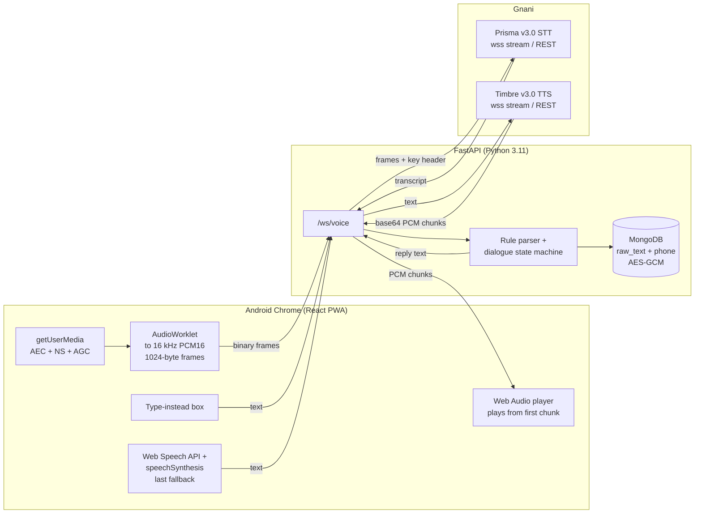

# BolKhata: a voice khata for kirana stores

Gnani Voice Hackathon, track PS2. A shopkeeper says *"Ramesh ne 340 udhaar liya"*. BolKhata understands it, reads it back, and saves it only after a "haan" or a tap on Save. The app works in Hindi, English, Kannada, Telugu, Tamil and code-mixed speech.

- Speech to text: Gnani **Prisma v3.0** over WebSocket streaming
- Text to speech: Gnani **Timbre v3.0** over WebSocket streaming (voice Shivani)
- The parser is rule-based, with no LLM involved. A balance question is answered in a few milliseconds on the server.
- On the first turn the assistant says it is an AI.
- Nothing is saved before confirmation.
- Demo data is synthetic.
- Reminders are polite.

## Architecture



The Gnani key stays on the server, which adds it as a header on the backend-to-Gnani connections. The browser never sees it.

**Voice engines.** The engine button in the app bar cycles through them. On a failure the app moves to the next one automatically:
1. **Gnani Live.** The mic stays open for the whole conversation. While the app speaks it sends silence frames, so it doesn't hear itself.
2. **Gnani REST.** Tap to start and stop each sentence. The audio is sent to `POST /stt/v3` (30 s max), and the reply audio comes from `/api/v1/tts/inference`. Gnani's WAV header sizes are rewritten before playback.
3. **Browser.** Chrome's Web Speech API listens and `speechSynthesis` speaks.

**Barge-in (🗣, off by default, meant for earphones).** When it's on, the mic sends real audio during replies. When Gnani reports `speech_start`, the server closes the TTS socket and the browser stops playback.

**Auto language.** The reply uses the language with the most words in the sentence. Gnani's `detected_language_code` breaks ties. Short Latin or Hindi replies ("haan", "430") keep the current language. A single Kannada, Telugu or Tamil word ("ಹೌದು", "ஆமாம்") switches to that language, because the script can only be that language. The whole UI switches with the reply.

**Shop's regional language (Settings).** In Auto, Gnani normally guesses among all Indian languages, and sometimes hears Kannada or Tamil as Telugu. Setting the shop's regional language makes Auto send Gnani `hi-IN,en-IN,<regional>` instead (Prisma v3.0 accepts up to 4 codes).

## Run it

Requirements: Docker (Docker Desktop or Colima) and Node 18+.

```bash
cp .env.example .env
```
Then edit `.env`: set `GNANI_API_KEY`, and set `ENCRYPTION_KEY` to the output of the command written in that file.
```bash
cd frontend && npm install && npm run build && cd ..
```
```bash
docker compose up -d --build
```
Then open http://localhost:8000.

To run the tests (Gnani is mocked, so the real API is never called):
```bash
docker compose exec backend python -m pytest -q
```

For local development without Docker for the API: `cd backend && python3 -m venv .venv && .venv/bin/pip install -r requirements-dev.txt`. Then start MongoDB, export the env vars and run `.venv/bin/uvicorn app.main:app --reload`, with `cd frontend && npm run dev` in a second terminal (it proxies `/api` and `/ws` to port 8000).

### Environment variables

| Variable | Meaning |
|---|---|
| `GNANI_API_KEY` | Gnani/Vachana key. Backend only. Without it the app falls back to the browser's speech engine. |
| `ENCRYPTION_KEY` | 32 random bytes, base64. Encrypts `raw_text` and `phone` at rest. Required. If you lose it, the stored text can't be read. |
| `SEED_DEMO` | `true` (default) seeds synthetic demo customers; `false` starts empty. |
| `MONGO_URL` | Defaults to `mongodb://localhost:27017` (compose sets `mongodb://mongo:27017`). |

## Demo script

Seed data (synthetic): Ramesh (Gandhi Nagar) ₹450, Ramesh (Station Road) ₹200, Lakshmi ₹120.

1. Open the app and tap 🎤 once. This tap is needed because browsers block audio until the user taps. The app greets you and says it is an AI.
2. "Ramesh ne 100 udhaar liya". It asks which Ramesh. Say "Station Road wala", then "haan". It saves, and Station Road's balance is 300.
3. "Ramesh ka total kitna?" It answers with both balances: Gandhi Nagar 450, Station Road 300.
4. "लक्ष्मी का बाकी कितना है". It answers "Lakshmi का बाकी 120 रुपये है।"
5. "ರಮೇಶ್ 200 payment ಕೊಟ್ಟರು". It asks which Ramesh, in Kannada. Say "ಮೊದಲ", then "ಹೌದು". It replies in Kannada, and the balance is 250.
6. "Suresh took 500 on credit". It confirms a new customer. Say "nahi 450", then "yes". It saves ₹450.
7. 📊 shows today's totals and the table. ⬇ downloads the CSV, which opens in Excel with Hindi intact.
8. Turn on 🗣 with earphones and talk over a reply. The reply stops.
9. Repeat any step by typing in the "type instead" box. The same parser and confirm flow handle it.
10. "Lakshmi ke liye paanch kilo cheeni order karo", then "haan". Then "pending orders batao", "Lakshmi ka saamaan aa gaya", "haan", and tap 💬.
11. "Ramesh ne assi rupaye udhaar liya", then "naya grahak", "Bus Stand", "haan". A third Ramesh is saved with area Bus Stand.

## Judges' additions

- **Customers are added automatically.** Any confirmed sale or order with a new name creates the customer. A known name adds to that customer's record, and the list shows each customer's last visit. When the name matches 2+ customers, the "which one?" choices include **New customer**. Choosing it asks for the area ("skip" is allowed), so two Rameshes stay apart.
- **Back-orders.** "Lakshmi ke liye 5 kilo cheeni order karo" or "Sita ko 2 packet Maggi baad mein deni hai" confirms and then saves a pending order. "pending orders batao" reads them out. "Lakshmi ka saamaan aa gaya" (confirm) marks it arrived and shows a **Tell on WhatsApp** button. The 📦 Orders tab has Arrived / Tell on WhatsApp / Delivered buttons; Delivered closes the order. WhatsApp opens with the polite message ready and the shopkeeper presses send. Nothing is sent automatically, and no paid SMS or WhatsApp provider is needed.
- **Evening check.** Once a day after the shop closing time (Settings, default 20:00), Home shows a banner and speaks a list of customers with no phone number and all pending orders. Tapping a name opens that customer's page to add the phone. It appears only while the app is open; there are no push notifications.
- **Noise.** The browser's noise suppression, echo cancellation and auto-gain are on, and the app sends silence while it speaks. Not yet tested in a real noisy shop.

## Each command stands on its own

- **New command, fresh context.** Any new command (a phone number, a question, a full credit/payment, an order) drops the unfinished one, so the app never answers it with the previous question. Only a real follow-up uses earlier context: "He paid 200" right after Lakshmi means Lakshmi.
- **Request ids.** Every typed or spoken request carries an id that its reply echoes. The server handles one turn at a time, and the screen shows only the reply to the latest request. The old reply is cleared on submit, "Working on it…" shows meanwhile, and a new sentence stops the old reply's audio straight away.
- **Contacts.** "Save Arjun's number as 99999 99999", "Add Priya's number …", "Arjun ka mobile number … save karo", "Update Ramesh's phone number to …", and the same in Kannada/Telugu/Tamil. A new name becomes a new customer on confirm. The number is read back in two groups. If a number already belongs to someone else, the app says so before saving. A missing number or name is asked for. Phone numbers are stored as text and are never an amount.
- **Quick questions answered from the ledger:** "Show today's collections", "How much did I collect this week?", "Who owes me the most?"

## Undo

After any save (credit, payment, new customer, phone number, order, arrival), an **↩ Undo** button shows for 10 seconds. Saying "undo", "galti ho gayi", "wapas lo", "ತಪ್ಪಾಯ್ತು", "తప్పు అయింది" or "தப்பா போச்சு" does the same. It reverts only that last action. After 10 seconds nothing changes, and the app says so.

## LLM brain (optional)

Messy, rambling speech ("yaar woh Lakshmi aayi thi, teen sau ka saamaan le gayi") goes to an LLM. Clear commands never do.

1. The **rules** run first. Clear commands and answers the rules understand take the fast path (about 0 ms).
2. Only if the rules **missed** (didn't understand) or **guessed** (a name that matches nobody, "came by" with no pending order, a phone number, a lone name) does the backend ask **Groq** (`openai/gpt-oss-120b`, 1.5 s timeout). If Groq fails, it asks **Gemini** (`gemini-3.5-flash-lite`, 2 s). If both fail, the rules' answer is used, exactly as without an LLM.
3. **Code checks every LLM answer** (`backend/app/brain/validator.py`):
   - An amount counts only if it was actually spoken. The app's own number reader checks it, including Hindi words and dedh/dhai/saade/paune.
   - A customer must exist or have been spoken.
   - Phone digits never become an amount.
   - A choice must be one of the offered options.
4. **The LLM never saves and never does maths.** Ledger actions go through the same confirm step. Balances come from the database. The LLM never sees balances or phone numbers.
5. Ledger replies use the fixed templates. The LLM's own text is spoken only for small talk, help and "unclear". That text is cleaned: plain text, 200 characters max, no markdown or emoji. If it contains pressure or threat words (`BANNED` in `prompts.py`), it is dropped.
6. Single meaningless spoken words ("hmm") are ignored and never sent to the LLM.

The latency line shows who answered (`rules` or `groq 640 ms`). The 🧠 button switches the LLM off for the session; it appears only when a key is set.

**Keys.** Put them in `.env` at the project root (backend only, never sent to the browser, ignored by git). Then restart the backend with `docker compose up -d backend`:
```
GROQ_API_KEY=...      # console.groq.com -> API Keys
GEMINI_API_KEY=...    # aistudio.google.com -> Get API key
GROQ_MODEL=           # empty = openai/gpt-oss-120b
GEMINI_MODEL=         # empty = gemini-3.5-flash-lite
LLM_ENABLED=true      # false = rules only
```
Either key alone also works. With no keys the app runs on rules only.

## Known limitations

- **The Kannada, Telugu and Tamil strings were AI-written** and are marked `// VERIFY by native speaker` in `backend/app/prompts.py`.
- **The web mic needs HTTPS** (or `localhost`). On a phone, serve the app over HTTPS, for example behind a TLS tunnel or reverse proxy. Plain `http://<laptop-ip>:8000` won't get mic access in Chrome.
- **Latency depends on the network** to Gnani. The on-screen "STT" figure is Gnani's own `latency`. "Reply" is measured from transcript arrival until the first audio plays.
- **Tested against the real Gnani API from the server only.** Demo steps 1–6 were run by streaming Gnani-synthesised speech through `/ws/voice` into real Prisma v3.0 and Timbre v3.0. A real microphone, a human voice and phone playback have not been tested yet. Unit tests always mock Gnani.
- **Gnani writes Hinglish in Devanagari** ("स्टेशन रोड वाला", "टोटल", "पेमेंट"). The parser knows the common loanword spellings and matches area names by consonants, so "स्टेशन रोड" finds "Station Road". Rarer loanwords may be missed.
- **Parser limits.** Names are single words; notes such as "Station Road" tell same-named customers apart. Spoken number words: Hindi and English in full. For Kannada, Telugu and Tamil, the common words up to the hundreds and "thousand" are covered (AI-written, marked VERIFY). Amounts are whole rupees.
- **Names keep the script Gnani writes them in.** A new customer spoken in Hindi is saved as "सीता", while existing Latin names still match across scripts.
- **LLM brain is untested against the real Groq and Gemini APIs.** Request shapes follow the official docs (checked Nov 2026) and are covered by mocked tests. Real latency, Kannada/Telugu/Tamil reply quality and free-tier limits during a demo are unverified.
- **Name bias for Gnani.** Customer names are sent through `update_settings` as `bias`. If Gnani rejects that, the app shows a small warning and keeps transcribing.
